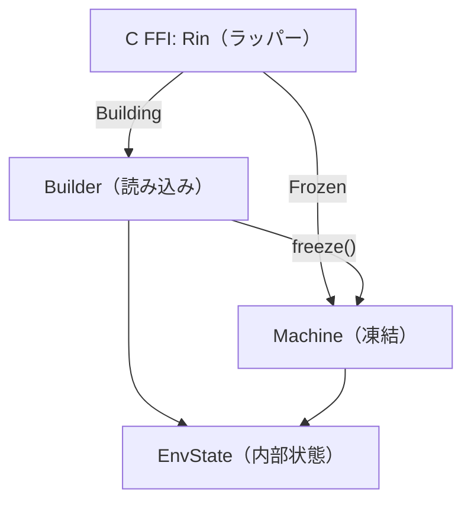
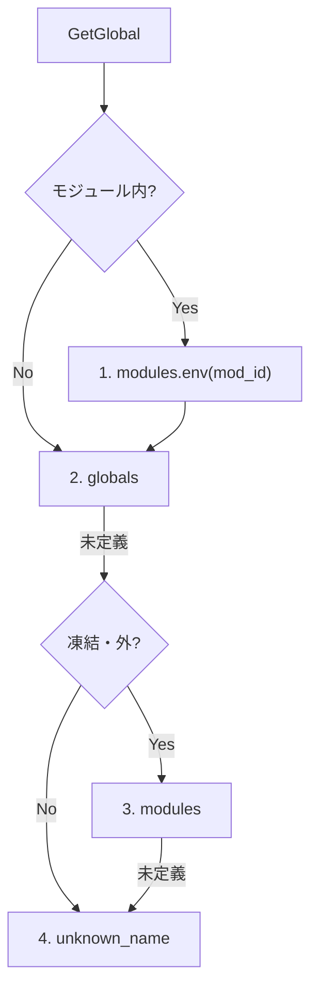

# 内部構成

Rin インタプリタ（`rin` クレート）の評価環境・コンパイラ・VM の内部構成をまとめる。仕様の正本は [言語仕様](spec.md) および [API 仕様](api.md) を参照すること。

## 1. 読み込み段階と実行段階の分離

評価環境は、公開 API を `Builder` と `Machine` の 2 つの型に分け、どちらも同じ内部構造体 `EnvState` を包む構成にしている（型定義は `rin/src/eval/mod.rs`、メソッド実装は `rin/src/eval/machine.rs`）。

- **`EnvState`**（内部状態）: `Pool`（3 領域メモリ管理・値プール・ゼロヒープ `ErrorStore`）、`SymTable`（シンボル番号表）、`globals`（大域スロット `EnvSlots`）、`modules`（モジュール表 `ModuleTable`）、`last_result` のほか、`limits`・`math_fma` を保持する。
- **`Builder`**（読み込み段階）: `Builder::new` / `Builder::with_memory_config` で生成し、`bind` / `bind_val`・`load_module` / `load_module_ref`・`eval` / `eval_ref` で大域環境とモジュールを構築する。`into_machine(self)`（または `std-value` 有効時の `freeze(self)`）で永続領域（`PermArena`）を凍結し、`EnvState` の所有権ごと `Machine` へ移行する。
- **`Machine`**（実行段階・凍結）: `eval` / `eval_ref`・`eval_with` / `eval_with_vals`・`call` / `call_ref`・`call_in` / `call_in_ref`（および `val_*`・`set_math_fma`・`math_fma`・`live_bytes`）を提供する。大域環境とモジュールを変更する操作を持たないことを型で保証する。
- **C FFI（`Rin`）**（`rin/src/ffi/mod.rs`）: `Rin` 本体・`ValueHandles` プール・インライン NUL 終端 `StoredError` をすべて `RinAllocator` 上に直接配置するゼロヒープ C ABI ラッパー。ポインタ型 `Rin*` を維持したまま `rin_freeze()` で不可逆に凍結する。`rin_new_with_config` で 3 領域のブロック設定（`RinMemoryConfig`）を指定できる。

## 1.5 3 領域メモリ管理（`rin/src/mem/`）

`Builder` / `Machine` の内部確保はすべて呼び出し元から渡された単一の `Allocator`（`ArenaAllocator` を含む）上で行い、システムヒープを使用しない。確保の寿命に応じて 3 つの領域に分離しており、各領域のブロック拡張設定は `MemoryConfig`（`RegionConfig`）で調整できる。

1. **永続領域（`PermArena`）**: `Chunk`・`FnProto`・`NameTable`・`SymTable`・`EnvSlots`・`ModuleTable`・インターン済み `StructDesc` 等を配置する。読み込み段階のみ追記でき、`Builder::into_machine()` / `freeze()` 以降は読み取り専用になる。
2. **オブジェクト領域（`ObjHeap` + `Pool`）**: 評価中に生成される `Obj` スロットと可変長ペイロード（文字列・配列・タプル・構造体値・クロージャ捕捉等）を管理する。解放時は追加確保なし・非再帰で反復解放し、解放の起点になったオブジェクト（種類を問わない）と `Obj::Cons` の鎖の続きは直接 `Slot::Free` へ戻し、それ以外の子のうち参照が 0 になったものは侵入型 `Slot::Dying` キューへ積む 2 経路を用いる。サイズ別フリーリストにより `dealloc` が何もしない `ArenaAllocator` 上でも解放済みブロックを即座に再利用し、反復評価時の使用量を一定に保つ。
3. **作業領域（`WorkArena`）**: ストリーミング字句解析・AST・コンパイラ一時構造・VM 値スタック（`RawVec<RVal>`）・呼び出しフレームスタック（非再帰 VM `drive_frames` と高階組み込み状態機械）・ソート一時バッファ等を配置する。評価終了時（成功・エラー問わず）に `WorkMark` へ一括巻き戻し、チャンクをそのまま再利用する。

エラー情報と最大 64 段の呼び出し履歴は `AllocCore` にインライン埋め込みされた `ErrorStore` へ直接書き込むため、OOM や Arena 枯渇時を含めエラー生成・`Display` でシステムヒープを一切確保しない。

## 2. 宣言の位置制限と凍結検査（1 パス）

宣言 4 形式（`def`・`defn`・`import`・`export`）はトップレベル（プログラム・モジュール・`deftest` 本体の最外側）のみに制限している（`rin/src/compiler/shallow.rs`、`rin/src/compiler/lower.rs`）。

コンパイラ `compile_program` は `frozen: bool` を受け取り、AST 走査の 1 パスで以下を検査する。

- **読み込み段階（`frozen = false`）**: トップレベルにある宣言のみバイトコードへ落とす。関数本体や式の中の入れ子宣言は構文エラー（`[expr.def]`・`[expr.defn]`・`[expr.module]`）として拒否する。これにより、凍結前に定義した関数を凍結後に呼び出して大域環境やモジュールを書き換える経路を根本から塞いでいる。
- **実行段階（`frozen = true`）**: トップレベル・入れ子を問わず宣言 4 形式をすべて `[env.frozen]` の構文エラーとし、評価を始める前に拒否する。
- **VM の防御ガード**（`rin/src/eval/vm/execute.rs`、`rin/src/eval/vm/ops_exec.rs`）: 実行時の多重防御として `Op::DefGlobal`・`Op::DefFn`・`Op::Import`・`Op::Export` にも `if self.frozen` の実行時エラーを残している。

## 3. 評価単位 `Runner` と `eval_with` の初期レキシカル束縛

1 回の評価（`eval`・`eval_with`・`call`・`call_in`）ごとに `EnvState::runner` で一時的な `Runner` を生成し、ステップ残量・呼び出し深さ・評価スタックを独立に管理する。読み込み段階の評価（`Builder::eval` / `rin_build`）では、新しく追加した大域束縛・`import` のシンボル ID を `Runner.added_globals` に記録し、途中でエラーになった場合は `EnvSlots::unset_no_alloc` で追加のメモリ確保なしにすべて取り消す。

`Machine::eval_with` / `eval_with_vals` / `rin_eval_with` の初期束縛は大域環境 `globals` へ書き込まず、コンパイル時に評価対象ソースの最外側の局所スロット（`scopes[0]`）として割り当て、実行時に `Runner::run_top_chunk_with_locals` でトップレベルフレームのローカルスロットへ配置する（`rin/src/compiler.rs`、`rin/src/eval/machine.rs`、`rin/src/eval/host_api.rs`）。

- **レキシカルスコープの徹底**: 初期束縛は評価するソース内では `Op::GetLocal`、そのソース内で生成されたクロージャからは `Op::GetCapture` で参照される。凍結済みの既存関数やそのクロージャには一切見えない（`[env.isolation]`）。
- **多数の初期束縛に対する O(N + M) 割り当て**: 初期束縛が 8 個以下のときはそのまま最外側スロットへ割り当て、9 個以上のときは AST に現れる識別子だけを小さなハッシュ表へ集めてから初期束縛を後ろから走査し、実際に参照される束縛だけを後ろ勝ちでスロットへ割り当てる（未参照の束縛に対してハッシュ表やローカルスロットを確保しない）。未定義名エラー時の候補名ヒント（`[eval.hints]`）が必要なときだけ、遅延して全初期束縛名を `NameTable` へ記録する。
- **値検証と解放**: `Machine::eval_with` ではソース中で参照されない束縛も `Pool::import` による検証・メモリ上限検査を行い、評価終了時（エラー時・上限超過時を含む）に全解放する。同名キーが重複した場合は後ろの束縛が有効になる。

## 4. 大域名の解決順（`Runner::lookup_global`）

VM の `Op::GetGlobal(id)` は `Runner::lookup_global`（`rin/src/eval/runner.rs`）で次の順に名前を解決する（`eval_with` の初期束縛はコンパイル時に `Op::GetLocal` / `Op::GetCapture` へ解決済みのため、この経路には現れない）。

1. **モジュール環境**: モジュール関数内（`active_module = Some(mod_id)`）なら、そのモジュールの環境 `modules.env(mod_id)`（`ModuleTable` 内）を参照する（ここでは未 `import` の他モジュールは参照しない：`[env.modules]`）。
2. **大域環境**: `globals`（`EnvSlots`：組み込み・`pi`・読み込み段階で定義した変数と関数）を参照する。読み込み段階での組み込み名の上書きや同名再定義は禁止されている。
3. **凍結後のモジュール名**: 上記で見つからず、かつ `frozen && active_module.is_none()` のときは読み込み済みモジュール表 `modules` を参照し、`import` なしで `mod_name.symbol` を引けるようにする。
4. **未定義エラー**: どれにも無ければ `unknown_name`（`[expr.name]`）を返し、その時点で可視な名前だけを候補として提示する。

### 補足: `lookup_global` のインライン展開について

`lookup_global` は `exec_rin_frame` のホットパスから呼ばれるため、`#[inline(never)]` で切り離すと大域参照ごとの呼び出し費用が `fib`・`tail`・`recur` に直接表れる。そのため `#[inline(always)]` を維持し、`unknown_name` のエラー構築だけを `#[cold]` で分離している。
