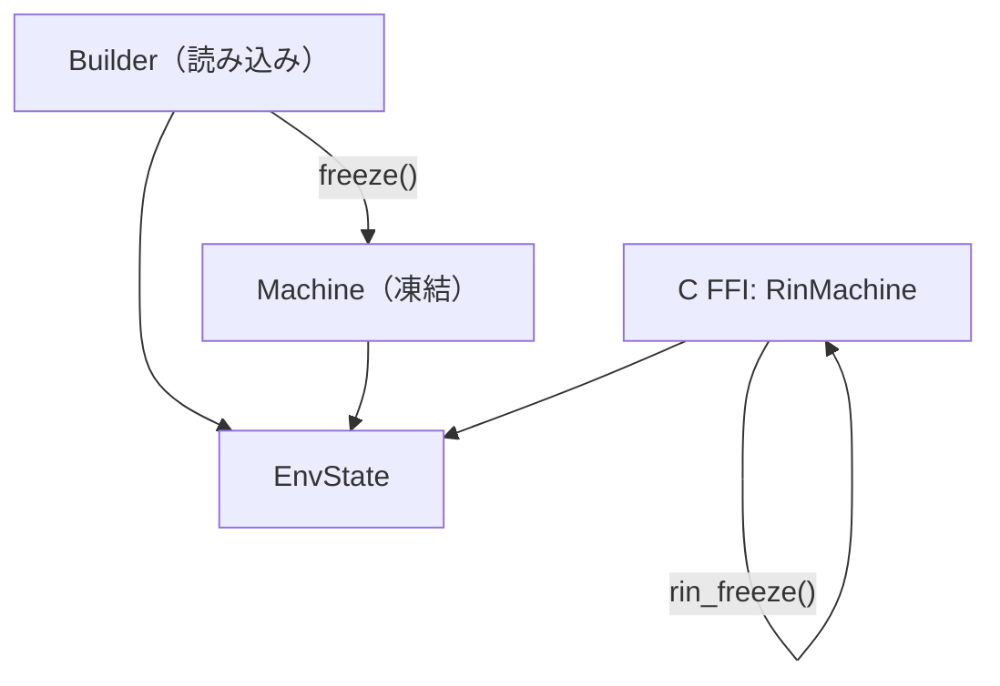
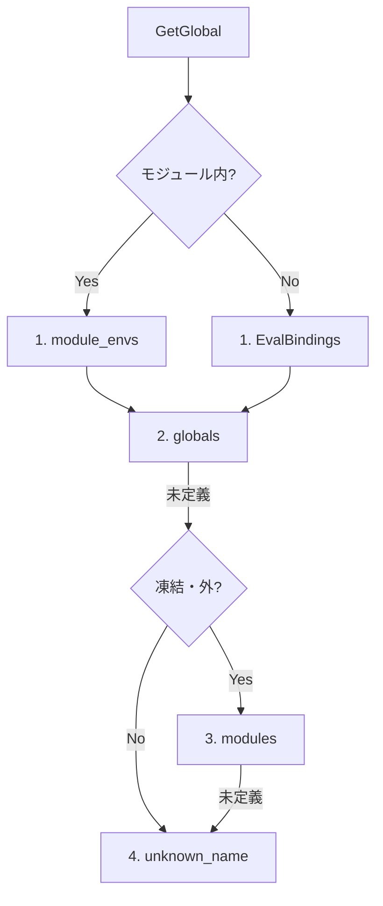

# 内部構成

Rin インタプリタ（`rin` クレート）の評価環境・コンパイラ・VM の内部構成をまとめる。仕様の正本は [言語仕様](spec.md) および [API 仕様](api.md) を参照すること。

## 1. 読み込み段階と実行段階の分離

評価環境は、公開 API を `Builder` と `Machine` の 2 つの型に分け、どちらも同じ内部構造体 `EnvState` を包む構成にしている（型定義は `rin/src/eval/mod.rs`、メソッド実装は `rin/src/eval/machine.rs`）。

- **`EnvState`**（内部状態）: `Pool`（値プールとメモリ上限管理）、`SymTable`（シンボル番号表）、`globals`（大域スロット）、`modules`（公開済みモジュール）、`module_envs`（モジュール固有環境）、`ParseScratch`（再利用パーサ作業領域）を保持する。
- **`Builder`**（読み込み段階）: `bind`・`load_module`・`eval` で大域環境とモジュールを構築する。`freeze(self)` で `EnvState` の所有権ごと `Machine` へ移行する。
- **`Machine`**（実行段階・凍結）: `eval`・`eval_with`・`call`・`call_in` のみを提供する。大域環境とモジュールを変更する操作を持たないことを型で保証する。
- **C FFI**（`rin/src/ffi/mod.rs`）: ポインタ型 `RinMachine*` を維持したまま内部で `Building` / `Frozen` 状態を持ち、`rin_freeze()` で不可逆に凍結する。凍結後の `rin_bind` / `rin_load` は `[env.frozen]` で拒否する。

## 2. 宣言の位置制限と凍結検査（1 パス）

宣言 4 形式（`def`・`defn`・`import`・`export`）はトップレベル（プログラム・モジュール・`deftest` 本体の最外側）のみに制限している（`rin/src/compiler/shallow.rs`、`rin/src/compiler/lower.rs`）。

コンパイラ `compile_program` は `frozen: bool` を受け取り、AST 走査の 1 パスで以下を検査する。

- **読み込み段階（`frozen = false`）**: トップレベルにある宣言のみバイトコードへ落とす。関数本体や式の中の入れ子宣言は構文エラー（`[expr.def]`・`[expr.defn]`・`[expr.module]`）として拒否する。これにより、凍結前に定義した関数を凍結後に呼び出して大域環境やモジュールを書き換える経路を根本から塞いでいる。
- **実行段階（`frozen = true`）**: トップレベル・入れ子を問わず宣言 4 形式をすべて `[env.frozen]` の構文エラーとし、評価を始める前に拒否する。
- **VM の防御ガード**（`rin/src/eval/vm/execute.rs`）: 実行時の多重防御として `Op::DefGlobal`・`Op::DefFn`・`Op::Import`・`Op::Export` にも `if self.frozen` の実行時エラーを残している。

## 3. 評価単位 `Runner` と `eval_with` の一時束縛

1 回の評価（`eval`・`eval_with`・`call`・`call_in`）ごとに `EnvState::runner` で一時的な `Runner` を生成し、ステップ残量・呼び出し深さ・評価スタックを独立に管理する。

`Machine::eval_with(source, bindings)` の一時束縛は大域環境 `globals` へ書き込まず、`Runner` が参照する `Option<&EvalBindings>` として評価中だけ保持し、評価終了時（エラー時・上限超過時を含む）に全解放する（`rin/src/eval/machine.rs`）。

一時束縛の格納には `EvalBindingValues`（`rin/src/eval/mod.rs`）の 2 経路を使う。

- **8 個以下（`Inline`）**: スタック上の固定長配列 `[(u32, RVal); 8]` に格納し、ヒープ確保を避ける。
- **9 個以上（`Map`）**: `BTreeMap<u32, RVal>` に格納し、取り込み O(N log N)・参照 O(log N) を保つ。

ソース中で参照されない束縛も `Pool::import` によるメモリ上限検査を行ってから即座に解放する。また、同名キーが重複した場合は後ろの束縛が有効になり、上書きされた旧値はその場で解放する。

## 4. 大域名の解決順（`Runner::lookup_global`）

VM の `Op::GetGlobal(id)` は `Runner::lookup_global`（`rin/src/eval/runner.rs`）で次の順に名前を解決する。

1. **モジュール関数内（`active_module = Some(mod_id)`）**: そのモジュールの環境 `module_envs[mod_id]` を参照する。ここでは `eval_with` の一時束縛や、未 `import` の他モジュールは参照しない（`[env.modules]`・`[env.isolation]`）。
2. **モジュール外（`active_module = None`）**: `eval_with` の一時束縛（`EvalBindings`）があれば先に参照する。
3. **大域環境**: `globals[id]`（組み込み・`pi`・読み込み段階で定義した変数と関数）を参照する。
4. **凍結後のモジュール名**: 上記で見つからず、かつ `frozen && active_module.is_none()` のときは読み込み済みモジュール一覧 `modules` を参照し、`import` なしで `mod_name.symbol` を引けるようにする。
5. **未定義エラー**: どれにも無ければ `unknown_name`（`[expr.name]`）を返し、その時点で可視な名前だけを候補として提示する。

### 補足: `lookup_global` のインライン展開について

`lookup_global` は `exec_frame` のホットパスから呼ばれるため、`#[inline(never)]` で切り離すと大域参照ごとの呼び出し費用が `fib`・`tail`・`recur` に直接表れる。そのためインライン展開可能な形を維持し、`unknown_name` のエラー構築だけを `#[cold]` で分離している。
